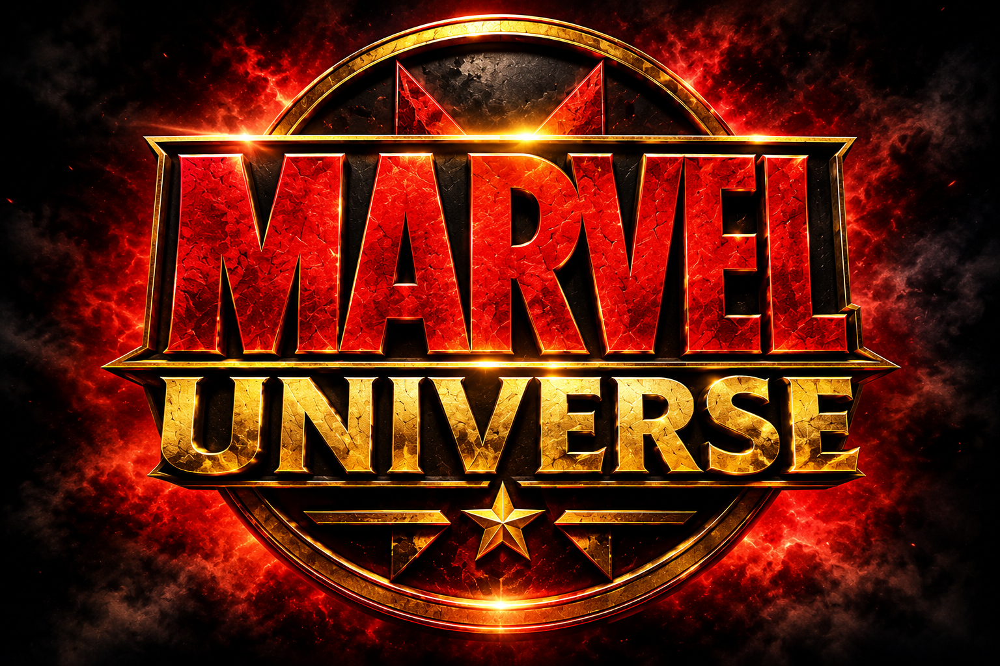

# Marvel Universe for Stremio

<p align="center">
  
</p>

<p align="center">
  A community catalog add-on for discovering Marvel movies and series in Stremio.
</p>

<p align="center">
  
</p>

## Features

- Marvel movie and series catalogs
- MCU movie chronology and MCU series chronology
- MCU release-order catalogs
- Collections for Spider-Man, X-Men, Avengers, Guardians of the Galaxy, Fantastic Four and Marvel Animation
- Each Stremio user enters their own TMDB API key in the add-on configuration

## Install in Stremio

1. Open the [Marvel Universe add-on manifest](https://marvel-universe-stremio.onrender.com/manifest.json).
2. Install the add-on in Stremio.
3. When prompted, enter your own **TMDB API Key (v3)**.
4. Finish the installation and open **Discover** in Stremio. Look under **Movies** or **Series** for the Marvel catalogs.

**Install URL:**
`https://marvel-universe-stremio.onrender.com/manifest.json`

## Get your own TMDB API key

1. Create a free account at [The Movie Database (TMDB)](https://www.themoviedb.org/).
2. Open [TMDB API settings](https://www.themoviedb.org/settings/api).
3. Request an API key if you do not already have one.
4. Copy the **API Key (v3 auth)** and enter it in the Marvel Universe add-on configuration in Stremio.

Use your own key. Do not share it publicly.

## What this add-on does

Marvel Universe provides catalogs and metadata for Stremio Discover. It does **not** provide video streams or host movie/episode files. Playback is handled by the streaming add-ons you have installed separately.

Metadata, artwork and descriptions are retrieved from TMDB.

## MCU viewing order

The movie and series timelines are separate catalogs because Stremio catalogs support one content type at a time (`movie` or `series`). To follow the combined MCU timeline, use both chronology catalogs.

## Privacy and API key

Your TMDB API key is entered into Stremio's add-on configuration and is used by the add-on server to request metadata from TMDB on your behalf. Only enter a key you are comfortable using with this community add-on. Keep your key private and do not post it in issues, screenshots or public messages.

## Run locally (development)

Requirements: Node.js 18 or newer.

```bash
npm install
npm start
```

Then open `http://127.0.0.1:7000/manifest.json` in Stremio and configure your own TMDB API key when prompted.

## Credits

- [TMDB](https://www.themoviedb.org/) provides the movie and television metadata.
- This project is an independent community add-on and is not affiliated with or endorsed by Marvel, Disney or TMDB.
